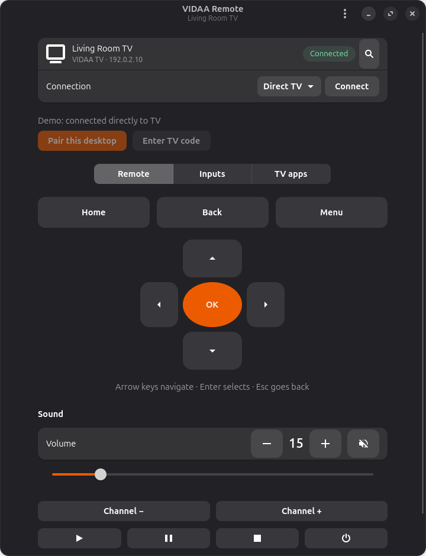

# VIDAA Remote for GNOME

A native GTK 4 and libadwaita remote control for VIDAA televisions on Ubuntu.
Pair the desktop with its own TV authorization and control the TV over your
local network. Direct control does not require the phone to stay connected.



The screenshot uses fictional TV data. This is an independent community project,
not an official VIDAA or Hisense application.

## Features

- Discover compatible TVs with SSDP, or enter an IP address.
- Pair using the code displayed on the TV, with a separate desktop identity.
- Keep access and refresh tokens in GNOME Keyring.
- Navigate, adjust volume, mute, change channels, and send playback keys.
- Select TV inputs and launch apps returned by the TV.
- Use arrow keys, Enter, and Escape from the remote page.
- Send Wake-on-LAN requests when the TV's standby settings support them.
- Optionally operate the installed VIDAA Android remote over authorized USB ADB.

## Requirements and compatibility

Ubuntu 24.04 or newer is recommended. The interface requires GTK 4.12 or newer,
libadwaita 1.5 or newer, Python 3.10 or newer, and a desktop secret service such
as GNOME Keyring. The computer and TV must be on the same local network.

Modern VIDAA transport protocol 3290 has been tested with independent pairing,
token reconnection, volume changes, remote volume keys, input enumeration, and
app enumeration. Model and firmware differences can affect behavior. Older
static-login TV firmware is not currently supported. Wake from standby, every
remote key, and every input or app launch have not been validated across models.

## Install on Ubuntu

Install the system libraries:

```sh
sudo apt install git python3 python3-venv python3-gi python3-gi-cairo \
  gir1.2-gtk-4.0 gir1.2-adw-1 gir1.2-secret-1 gnome-keyring openssl
git clone https://github.com/ijaz-miks/vidaa-remote-gnome.git
cd vidaa-remote-gnome
/usr/bin/python3 tools/install.py
```

The installer creates a user-local virtual environment, verifies the pinned
Paho MQTT wheel against its SHA-256, retains the downloaded wheel and dependency
licenses, and installs the GNOME launcher and icon. It does not overwrite an
existing installation. It accepts `--data-home` and `--bin-dir` for a separate
installation, and `--wheel` for an already downloaded Paho 2.1.0 wheel.

Launch **VIDAA Remote** from the GNOME application menu, or run:

```sh
~/.local/bin/vidaa-remote
```

## Certificate setup

The TV requires a client certificate distributed with the official VIDAA Android
app. This repository does not include that certificate, its private key, APKs,
or pairing tokens. Supply the certificate locally from your own copy of the app.

If you already have a combined client certificate and private-key PEM:

```sh
/usr/bin/python3 tools/import_certificate.py --pem /path/to/your/client.pem
```

To import from your own official VIDAA base APK:

```sh
/usr/bin/python3 tools/import_certificate.py --apk /path/to/your/base.apk
```

The importer prompts locally for the P12 archive password. The shared archive
format and password are described in the upstream
[protocol research](https://github.com/tombabolewski/vidaa-control/blob/main/docs/PROTOCOL.md).
The password is not written to a file or included in this repository. For
automation, the importer can read `VIDAA_PKCS12_PASSWORD` from the environment.

Alternatively, connect an Android phone with the official VIDAA app and authorized
USB debugging. Install ADB, then import directly without retaining a copy of the APK:

```sh
sudo apt install adb
/usr/bin/python3 tools/import_certificate.py --from-device
```

Use `--serial` if several Android devices are connected. The importer validates
that the private key matches the certificate and writes the combined PEM to
`~/.config/vidaa-remote/client.pem` with mode `0600`. It preserves existing files.

## Pair and use the TV

1. Turn on the TV and use **Find a TV** to select it.
2. Select **Direct TV**, then **Pair this desktop**.
3. Enter the current four-digit code displayed on the TV.
4. The application stores its own tokens in GNOME Keyring and reconnects with
   the issued token before enabling controls.

Keep one desktop connection open during pairing. Restarting it can invalidate
the displayed code. If the TV closes its code dialog, request a fresh code.
Some firmware can delay or suppress pairing while another remote session is
active; closing the phone remote and retrying can help. This behavior is not
consistent across models.

The input and app pages use objects returned by the TV, rather than assuming
fixed input numbers or app URLs. Arrow keys navigate, Enter selects, and Escape
goes back when the remote page has focus. Text fields and dialogs keep their
normal keyboard behavior.

## Optional USB phone mode

USB phone mode operates the existing VIDAA Android remote through ADB. It supports
the phone layout's navigation, volume, channel, and input controls. It requires
the installed app to be connected to the TV and open on its remote screen.
Controls stop if another app takes focus. This mode does not read or import the
phone's TV pairing credentials.

ADB is located through `PATH`, or `VIDAA_ADB` can specify an executable. Set
`VIDAA_DEVICE_SERIAL` to choose a phone when several are connected. This mode is
an experimental fallback and depends on the Android app's resource layout.

## Privacy and security

- TV authorization tokens are stored only in the desktop secret service.
- Device discovery and commands use the local network. Direct control has no
  cloud relay or VIDAA account login.
- The TV's certificate fingerprint is recorded on first connection and checked
  before MQTT credentials are sent on subsequent connections.
- Commands stay disabled until authorization succeeds. Mutating commands are
  not automatically replayed after connection loss.
- Settings and client certificates stay under `~/.config/vidaa-remote`, outside
  the repository. Never attach them, APKs, raw traffic captures, or pairing codes
  to a public issue.
- `--preview` uses fictional settings, never connects to a TV, and does not read
  real configuration or GNOME Keyring entries.

The initial certificate trust is based on the TV selected by the user. Pairing
requires the code displayed on that TV. If its fingerprint changes after a
firmware update, verify the device before editing the saved fingerprint.

## Development and checks

Create a virtual environment that can use the distribution's GTK bindings:

```sh
/usr/bin/python3 -m venv --system-site-packages .venv
.venv/bin/python -m pip install -e '.[test]'
.venv/bin/python -m unittest discover -s tests -v
.venv/bin/python app.py --preview
```

Tests generate their own TLS certificates and keys in a fresh temporary directory;
no private keys or certificate fixtures are committed. These files are retained
for inspection. `VIDAA_TEST_ARTIFACTS_DIR` can select their parent directory.
Tests use a local TLS/MQTT fixture broker and do not connect to a real TV.

To capture a demo screenshot:

```sh
.venv/bin/python app.py --preview --screenshot /path/to/new-demo.png --quit-after 6
```

The destination must not already exist. GitHub Actions runs the tests and a
headless preview using the minimum supported Ubuntu version.

## License and credits

MIT, copyright Ijaz Muhammed. See [LICENSE](LICENSE) and
[THIRD_PARTY_NOTICES.md](THIRD_PARTY_NOTICES.md) for dependency and protocol credits.
Protocol work used [REA](https://github.com/morluto/rea), native analysis of the
official Android app, and public research by Warren Rees and Tom Babolewski.
Their MIT notices are preserved under `licenses/`.
